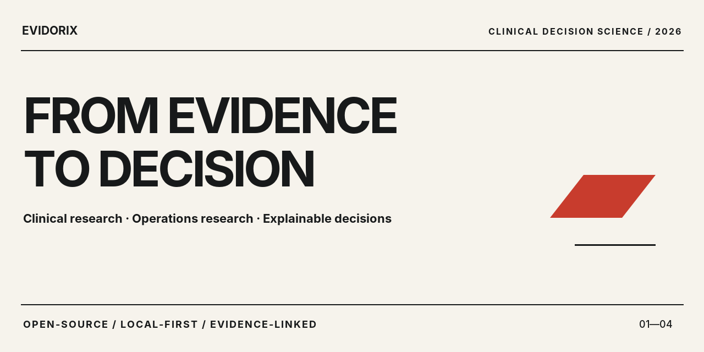

# EVIDORIX — Clinical Evidence & Decision Optimization

**From evidence to defensible decisions.** An open-source, condition-agnostic clinical evidence research and operations research workbench.



> EVIDORIX is a research prototype. The name and mark have not been cleared by trademark counsel.

> **Brand migration:** EVIDORIX is the public-facing identity. The existing `clinor` Python namespace and `CLINOR_*` environment variables remain unchanged in this release for backward compatibility. Branding is not clinical validation.

> **Version 0.3.1 — research prototype.** ClinOR is not a validated clinical decision support device, does not prescribe medication, and cannot confirm the clinical suitability of a treatment. All optimization inputs are explicitly authored for demonstration or reviewed by subject-matter experts. Mathematical optimality does **not** imply clinical superiority.

## What EVIDORIX does

EVIDORIX connects two **separate, auditable** workflows:

1. **Research discovery:** Search clinical topics spanning specialties using Europe PMC and optional publisher-site web discovery. A local or cloud LLM can plan queries and produce preliminary source-ID-linked evidence briefs. Discovery is not guideline verification.
2. **Operations research:** Apply multiple mathematical analysis methods to **synthetic or reviewer-defined** choices, scenarios, transitions, weights and restrictions. No AI search result is silently turned into a medical rule or treatment score.

This design deliberately avoids single-disease templates: you can research rheumatology, cardiology, neurology, infectious disease, oncology and others through the same discovery API. **Not all diseases have validated guideline packs; no disease has validated autonomous treatment selection in this release.**

## Engine inventory

| Algorithm family | Route | Implementation | Purpose |
|---|---|---|---|
| Mixed-integer linear programming (MILP) | `POST /api/optimize` | SciPy / HiGHS | Combinatorial selection with hard constraints |
| Constraint programming (CP-SAT) | `POST /api/or/cp-sat` | Optional OR-Tools extra | Discrete, logical selection constraints |
| Multi-criteria decision analysis (MCDA) | `POST /api/or/mcda` | TOPSIS and weighted sum | Single-option comparison under transparent weights |
| Multi-objective / Pareto analysis | `POST /api/or/pareto` | Exact dominance checks | Nondominated single alternatives |
| Stochastic scenario optimization | `POST /api/or/scenarios` | Scenario-weighted MILP | Maximize expected reviewer score |
| Robust scenario optimization | `POST /api/or/scenarios` | Maximin MILP | Maximize worst-case scenario score |
| Monte Carlo analysis | `POST /api/or/monte-carlo` | Seeded NumPy sampling | Analyze input-score uncertainty |
| Cohort Markov models | `POST /api/or/markov` | NumPy matrix propagation | Multi-cycle state-transition evaluation |
| Dynamic programming | `POST /api/or/dynamic-programming` | Finite-horizon Bellman recursion | Sequential decisions with supplied transitions |
| Queueing theory | `POST /api/or/queueing` | M/M/c (Erlang C) | Service capacity / waiting-time analysis |

Some are related categories or strategies rather than independent clinical algorithms. Not all branches of operations research are implemented, and **no method is automatically appropriate for every medical question**.

Machine-readable listing: `GET /api/or/algorithms`.

### Decision-method guidance

`POST /api/or/recommend` offers a **rule-based, auditable** shortlist of analysis methods from a structured problem description. It does not use an LLM to assume clinical validity. The analyst selects the final model and confirms its assumptions.

## Local or cloud LLM inference — new in v0.3

**Ollama is the default inference backend.** The same model workflow supports local LM Studio, llama.cpp or a cloud OpenAI-compatible endpoint. Local inference does not require API keys. All OR solvers work even if the model is unavailable.

```bash
ollama pull qwen2.5:3b       # once, on a machine running Ollama
cp .env.example .env
python -m pip install -e '.[dev]'
uvicorn clinor.api:app --reload
```

Open the UI, review **MODEL RUNTIME**, and click **Test model**. The LLM can generate targeted clinical literature searches, summarize cited retrieved evidence, and explain why an OR method might fit a problem; validated clinical guideline reasoning is **not** yet implemented. For exact configuration options, cloud consent and Docker Compose, read [Local & cloud provider guide](docs/LLM_PROVIDERS.md).

**Privacy distinction:** local model inference may be offline, but Europe PMC search still uses the internet with explicit user consent. A fully offline literature corpus is out of scope.

## Quick start

Requires **Python 3.11+**.

```bash
python -m venv .venv
source .venv/bin/activate             # Windows: .venv\Scripts\activate
python -m pip install -e '.[dev,ai]'
# Optional: install CP-SAT as well
python -m pip install -e '.[cp]'
uvicorn clinor.api:app --reload
```

Open **http://127.0.0.1:8000** for the UI and **http://127.0.0.1:8000/docs** for OpenAPI documentation.

The **OR workbench** now offers nine engine families, synthetic editable JSON inputs and structured output. The **evidence search** is condition-agnostic, requires explicit external-literature consent and must not receive identifiable patient data. Cloud LLM calls require separate consent.

### Use a mathematical engine

```bash
curl -sS -X POST http://127.0.0.1:8000/api/or/mcda \
  -H 'Content-Type: application/json' \
  --data-binary @examples/or_mcda.json

curl -sS -X POST http://127.0.0.1:8000/api/or/scenarios \
  -H 'Content-Type: application/json' \
  --data-binary @examples/or_scenarios.json

curl -sS -X POST http://127.0.0.1:8000/api/or/dynamic-programming \
  -H 'Content-Type: application/json' \
  --data-binary @examples/or_dynamic_programming.json
```

Explore all 9 machine-readable synthetic examples in [`examples/`](examples/). All samples are deliberately fictional and **not clinical case recommendations**.

### Research across specialties

```bash
curl -sS -X POST http://127.0.0.1:8000/api/research \
  -H 'Content-Type: application/json' \
  -d '{"condition":"asthma","question":"Find guideline and systematic review candidates","max_results":10,"consent_external_search":true,"use_ai":false}'
```

Public Europe PMC search needs no API key. For AI planning/synthesis, use a locally running Ollama or OpenAI-compatible model as configured in `.env` (loaded automatically from the project root), **or** explicitly enable a cloud provider with per-request consent. For publisher-site discovery, set `BRAVE_SEARCH_API_KEY` or opt into separate `OPENAI_WEB_SEARCH=1` with `OPENAI_API_KEY`, `ai-web` optional dependency, and cloud consent. See [LLM setup](docs/LLM_PROVIDERS.md) and [`.env.example`](.env.example).

## Architecture

```text
              Topic / question (de-identified)
                          |
          Local/cloud LLM query planner (optional)
                          |
            Europe PMC + optional web search
                          |
            Source metadata + evidence brief
                          |
      [HUMAN EVIDENCE & GUIDELINE VALIDATION]
                          |
     Reviewer-supplied alternatives, constraints,
     values, preferences, probabilities, transitions
                          |
     ┌────────────────── OR Workbench ──────────────────┐
     │ MILP, CP-SAT, MCDA, Pareto, scenarios, simulation│
     │ Markov, dynamic programming, M/M/c queueing      │
     └──────────────────────────────────────────────────┘
                          |
         Structured, auditable comparative analyses
                 (NO auto-prescribing)
```

**Trust boundaries:** source discovery is not evidence appraisal; publication metadata are not current approved clinical recommendations; model scores are not derived from abstracts; clinical constraints require an independently reviewed, maintained guideline implementation. Clinical mode also requires an unexpired operator-installed review record bound to the exact model inputs. See [review controls](docs/VALIDATION.md).

Read: [Architecture](docs/ARCHITECTURE.md), [OR Methods & Mathematical Assumptions](docs/OR_METHODS.md), [Existing MILP Model](docs/OPTIMIZATION_MODEL.md), [Security](SECURITY.md).

## Reproducibility and testing

```bash
python -m pytest -q
python -m compileall -q clinor
```

Tests include synthetic reference values (e.g. M/M/1 waiting time and Bellman policy), input validation, hard-constraint adherence, stochastic-versus-robust solution differences, API schema behavior and deterministic Monte Carlo sampling. The GitHub Actions workflow runs the tests after each push or PR. **Passing these tests is not clinical validation**.

## Development roadmap

- [x] Condition-agnostic literature search plus local/cloud LLM query planning, synthesis and OR method explanation
- [x] MILP with hard exclusion/prerequisite/incompatibility/budget constraints
- [x] MCDA, Pareto and uncertainty-aware comparison methods
- [x] Markov cohort and finite-horizon state/action models
- [x] Queueing analysis and optional CP-SAT
- [x] API contracts, sandbox UI, examples and automated tests
- [x] Ollama native and OpenAI-compatible model backends, provider status/connection test, opt-in cloud privacy gate
- [ ] Independently maintained and licensed guideline adapters, with versioning and expert review
- [ ] Verified evidence-to-rule transformation with medical terminology and provenance controls
- [ ] Validated patient-specific eligibility, contraindication and medication-interaction reasoning
- [ ] Robust security and PHI protection, FHIR/CDS Hooks interoperability and audit trails
- [ ] External clinical validation across specialties and prospective impact evaluation

## Clinical and legal scope

- Do not use this prototype to treat, diagnose, prescribe, dose or order medications.
- Do not send private patient information to the demo or external AI services.
- The underlying publication/guideline text can have separate copyright and license requirements.
- Regional deployment and clinical use require independent evaluation of safety, privacy, clinical quality, professional oversight and applicable regulations.

## Scientific and interoperability references

- [SciPy MILP documentation](https://docs.scipy.org/doc/scipy/reference/generated/scipy.optimize.milp.html)
- [OR-Tools CP-SAT documentation](https://developers.google.com/optimization/cp/cp_solver)
- [HL7 Clinical Practice Guidelines Implementation Guide](https://hl7.org/fhir/uv/cpg/)
- [WHO SMART Guidelines](https://smart.who.int/)
- [Europe PMC REST API](https://www.ebi.ac.uk/europepmc/webservices/rest/)

## Contribute

See [CONTRIBUTING.md](CONTRIBUTING.md), [SECURITY.md](SECURITY.md), [docs/PROJECT_CASE_STUDY.md](docs/PROJECT_CASE_STUDY.md). Original source code: **MIT**. Third-party guideline, terminology and article content retains its own rights.

## Verification

See the [running workspace screenshots](docs/PORTFOLIO_CASE_STUDY.md), [validation scope](docs/VALIDATION.md), [audit](docs/AUDIT.md), and [release checks](docs/RELEASE_VERIFICATION.md).
