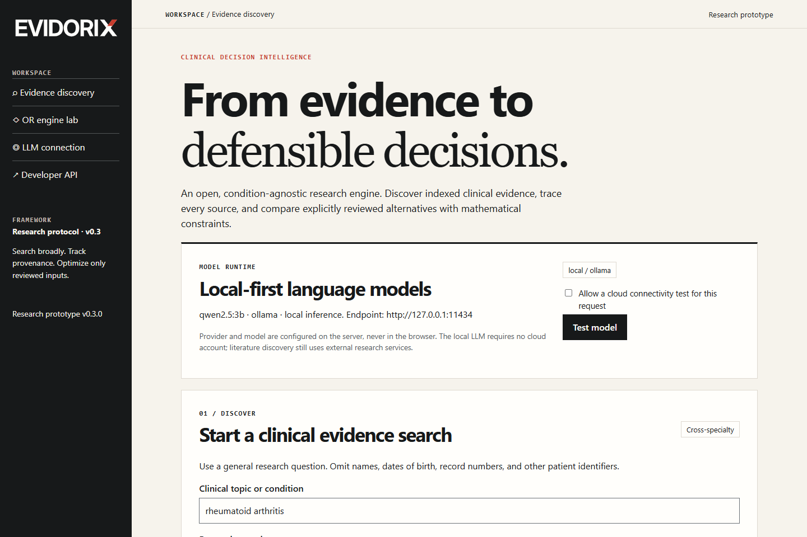
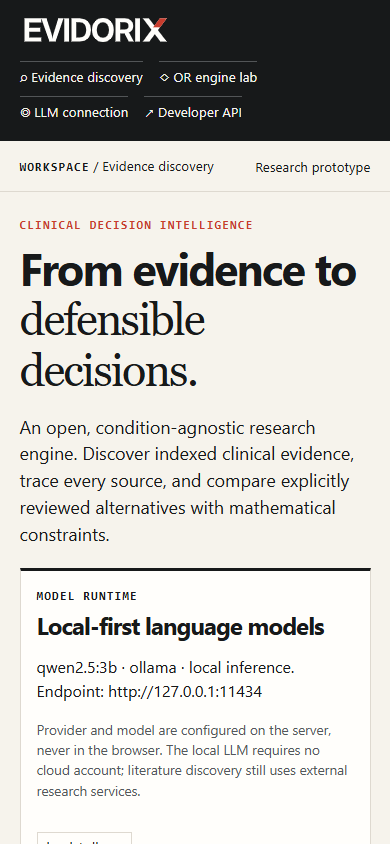
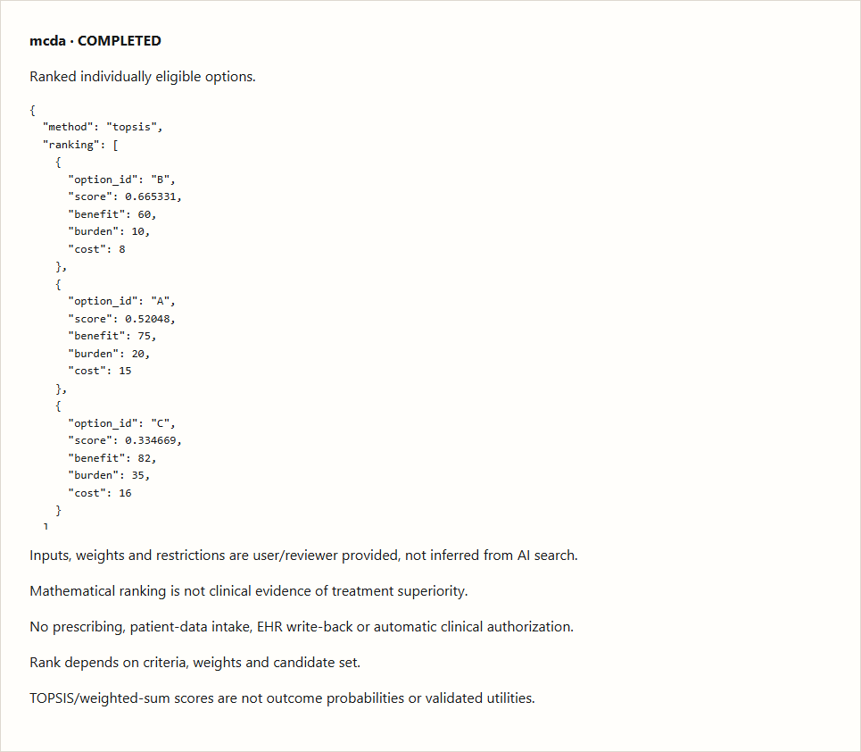

# EVIDORIX research workspace

The interface brings search planning, bibliographic provenance, model configuration and synthetic operations research into one local workspace. The API retains the clinor namespace and existing routes. Literature records enter through discovery adapters. A model may propose search terms and a source-linked narrative. Mathematical engines take explicit inputs and apply hard exclusions before calculating results. A professional reviews interpretation.

The editorial redesign uses the approved outlined mark, warm paper and ink surfaces, and a single typographic accent. The browser checks exercised actual engine submission at both viewport sizes. The screenshots show the local prototype. No benchmark used patient records.
